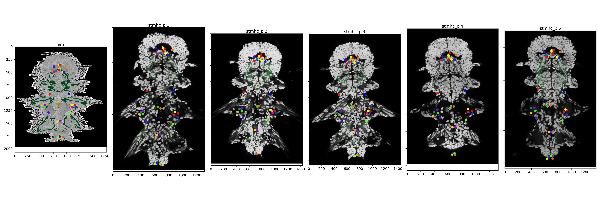
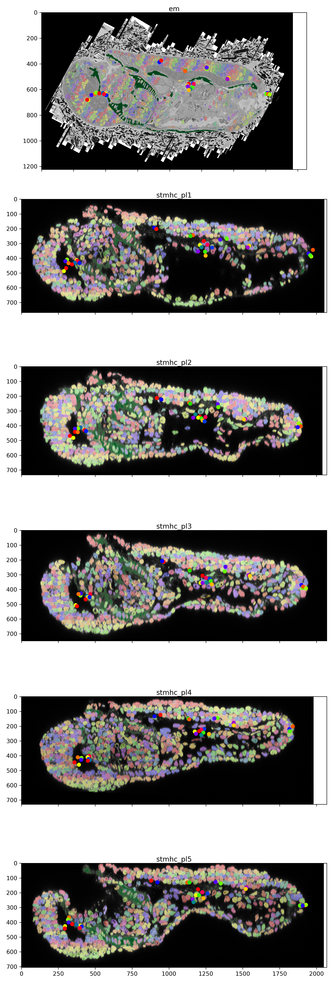

# Platy5+1
A benchmark dataset for deformable registration and object matching of biological images


Introduced in Rotation-invariant graph transformers enable global bioimage registration and cell matching



## Samples

| Sample name   | Modality | N nuclei | Volume shape (pixels) |
| -------- | ------- | ------- | ------- |
| stmhc_pl1  | fluorescence, confocal   |  10108 |   768x2054x1310 |  
| stmhc_pl2  | fluorescence, confocal   |  9496  |  768x2054x1310 |  
| stmhc_pl3  | fluorescence, confocal   |  10252  |  748x2070x1440 |  
| stmhc_pl4  | fluorescence, confocal   |  9857 |  729x1980x1330 |  
| stmhc_pl5  | fluorescence, confocal   |  10219 |  706x2050x1370 |  
| em  | SBEM   |  11488  |  1224x1962x1785 | 

## Dataset structure
- `match_gt.csv`: table listing corresponding nuclei between samples
- `match_gt.csv`: table listing corresponding nuclei between samples, left and right nuclei exchanged
- `{sample name}.csv`
    - label: segmentation mask ID
    - z, y, x: coordinates measured in pixels
    - mean_stmhc: mean intensity of StMhc staining within the cell mask. For EM calculated within nuclei masks instead of cells
    - reg_gt: annotated nuclei ID from `match_gt.csv`, otherwise `-1` (same ID for the same nucleus in different samples)
    - reg_gt_reflected: annotated nuclei ID from `match_gt.csv`, otherwise `-1`
- `{sample name}.ome.zarr`
    - / : CZYX volume with two channels: DAPI and StMhc staining. For EM: raw EM volume and muscle segmentation
    - labels
        - nuclei_segm
        - cell_segm
        - reg_gt: 

## Usage

Point clouds and matching ground truth annotations can be found in `data`. Images can be downloaded from BioImage Archive:

For data viewing and metrics install `platy5p1`

```
conda env create -f environment.yml
conda activate platy5p1_env
pip install -e .
```
For examples of working with the dataset see

- `examples/matching_evaluation.ipynb`

- `examples/view_images.ipynb`

`examples/matching` contains baseline matching used in the publication.

